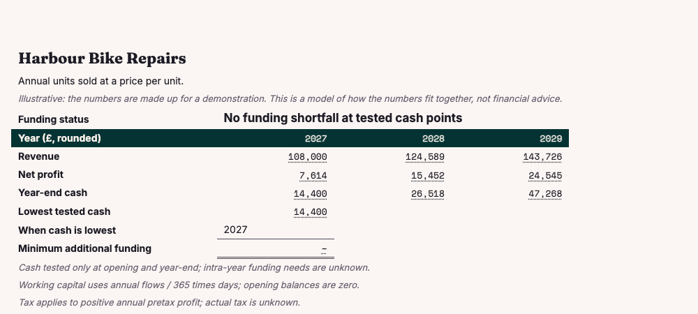

# nk-model

An agent skill for [Claude Code](https://code.claude.com) and [OpenAI Codex](https://developers.openai.com/codex). Ask your coding agent: “Build a three-year model for a bike-repair shop, with 2,400 average sales units in year one,
£45 revenue and £18 variable cost per unit.” It says which parts of the request the model covers, records every
number you did not give as a stated assumption, then makes an `.xlsx` with linked income statement, balance sheet
and cash flow, every calculated number a formula. Summary opens first with funding status, revenue, profit and cash:



<sub>The bundled illustrative example, captured from its generated HTML preview (`scripts/preview.py`); these are stored workbook values.</sub>

Building that example prints:

```text
wrote model.xlsx: Harbour Bike Repairs, 2027-2029 · 19,673 bytes · balanced to the penny in all 4 balance sheets
net profit 7,614, 15,452, 24,545 · cash at the end of each year 14,400, 26,518, 47,268 (£)
```

Edit a stored value by hand and the checker notices: changing `Income statement!B4` from 2400 to 2500 leaves its
formula intact but makes `model_check.py` exit 1 with four K03 findings. Its first finding is:

```text
K03 Income statement!B4 stores 2500.0 but its formula =IF(Assumptions!$B$44=1,SUM('Monthly sales'!F4:F15),Assumptions!$B$6) gives 2400.0
```

Part of [nickkk-skills](https://github.com/NickkkLian/nickkk-skills): 14 agent skills that work with numbers, check an agent's work, guard a repository, and write and present.

## Try it

Clone and build the bundled example:

```bash
git clone https://github.com/NickkkLian/nk-model && cd nk-model
cp assets/requests/bike-repair.json request.json
python3 scripts/make_model.py --preflight request.json
python3 scripts/make_model.py --init business.json
python3 scripts/make_model.py business.json -o model.xlsx
python3 scripts/model_check.py model.xlsx
python3 scripts/preview.py model.xlsx -o preview.html
```

Open `preview.html` (or `model.xlsx`) to see the seven sheets. No network, installs or spreadsheet application is
required to build/check files. Python 3.9+ standard library only.


## Scope and fit

For owners and analysts using a coding agent to make an annual model for **one sales line**, or subscriptions with
**uniform monthly churn and constant month-end additions**. Supports straight-line equipment depreciation over a
whole-year useful life with zero residual, or reducing balance. Summary includes minimum funding at tested dates,
warnings and two charts; Assumptions is second.

## Build a model

Read `SKILL.md` and `references/business-format.md`. Classify original requirements into `request.json` before
translating assumptions. Preflight validates declared capabilities and a few prose patterns; the agent must assess
everything else honestly. The code refuses unknown or unsupported feature names; the agent must identify and
refuse unsupported requirements that the limited prose checks miss.

The bundled illustrative bike-repair/parts example aggregates repairs and counter parts into **one average
sales unit**: 2,400 units in year one, £45 revenue and £18 variable cost per unit. It does not model separate
repair and counter-parts quantities, prices or margins. A request needing those separate lines must be classified
as `multiple_products` and refused; accepting this aggregate requires explicit agreement to that simplification.

The commands under [Try it](#try-it) build this bundled example; run them from the skill folder. For your own model,
replace all example inputs. Old inputs need explicit migration to scope, sales timing and depreciation fields.

Every calculated statement, monthly-schedule and Summary number is a formula with its value stored. The builder
compares selected statement values against a second plain-Python calculation inside the same builder, refusing
differences of half a penny or more; it does not independently verify every monthly or Summary cell. The balance
sheet balances at opening and every year, cash ties to cash flow, and profit reaches equity. Formulas are intended
to update dependent statements after numeric edits and recalculation; native Excel recalculation was not checked.
Statement totals display whole currency units; prices and unit costs display two decimals and Checks show pennies.
Computations generally retain precision, but near-zero opening cash and accounting-check differences with absolute
value below 0.005 are normalized to zero.

The user or agent supplies `illustrative` and, for real inputs, a `sources` sentence. The workbook repeats that
supplied provenance; the code validates its presence and consistency, not whether the numbers or sources are authentic.

Subscriptions bill opening-month customers, apply uniform churn, then add customers at month end. New customers
pay next month; fractional customers are expectations. Straight line starts opening new assets in year one and
year-end purchases the following year; depreciation stops after useful life. One opening loan uses equal annual
principal and interest on opening balance. Tax is on positive annual profit, with no loss carryforward. These
conventions appear in the workbook.

Summary has the business name in row 1 and the modeled sales description in row 2. Its method descriptions
are formulas based on live inputs: equipment and loan descriptions appear only when funded amounts exist,
and start-of-year equipment is distinguished from recurring year-end purchases. Their native Excel updates
were not checked. The sales description is generated from the selected model. Original description, defaults
and scope notes remain on Assumptions.

Funding and its warning use the lowest opening/year-end cash: below −0.005 currency units, funding is the
absolute shortfall; otherwise it is zero. A shortfall of exactly half a penny, or less, produces zero funding
and no funding warning. This threshold does not measure within-year funding needs.

## Check before sharing

```bash
python3 scripts/make_model.py --selftest
python3 scripts/model_check.py --selftest
python3 scripts/numsrc.py --selftest
python3 scripts/ooxml.py --selftest
python3 scripts/preview.py --selftest
python3 scripts/xlformula.py --selftest
```

All six existing suites pass in 0.2.1. The HTML preview is offline and shows stored values; click a number for its
cell and formula. It does not recalculate. The checker uses the shipped evaluator and rebuilds a reference from
builder code, so the user or agent still needs a separate calculation to verify that the method fits the original
business description. 
This README describes version 0.2.1. How this version was tried, with the complete recorded command output, is in
[VERIFICATION.md](VERIFICATION.md).

## Limits

The agent must classify **every material requirement** and refuse cohort-specific churn, seasonality, monthly
cash forecasts, product mix, prepaid/deferred revenue, custom depreciation, opening working capital and
nonstandard financing. The code validates the **declared features and a limited set of wording patterns**;
an unsupported need expressed in other words can pass if it is omitted from the declaration. In outside
testing, a monthly-cash request declared only as annual sales passed preflight, build and checker, producing an
annual workbook; a sentence denying seasonality was refused because the wording check did not understand
negation. Preserve the original prose, disclose the classification and resolve mismatches rather than deleting
words to obtain a pass.

Working capital uses annual revenue for receivables and annual cost of sales for inventory/payables, each
multiplied by its days / 365. Cash checks cover opening and **year-end** only: reported funding covers those
tested dates and can miss any size of intra-year shortfall. The agent procedure requires fit assessment before
assumption translation; the CLI does not enforce that history. This is not financial advice.

## What was not checked

- Saving in Microsoft Excel, repair-free opening as a specific acceptance check, native Excel recalculation,
  and chart refresh after native input edits. See `references/acceptance.md` for those checks.
- Other spreadsheet engines and arbitrary prose comprehension.
- Formatting changes, hidden rows/columns, text boxes, extra charts, chart titles/year caches, data connections and
  precision-as-displayed are not fully inspected by the checker.
- Full visual fit and clipping in Excel; the offline raster renderer's width/height heuristic is not a complete visual audit.

The recorded command checks used no GUI automation. Large compounded sums can
exceed floating-point penny precision. Fonts fall back where not installed. This shows how stated assumptions fit
together, not whether they are realistic.
